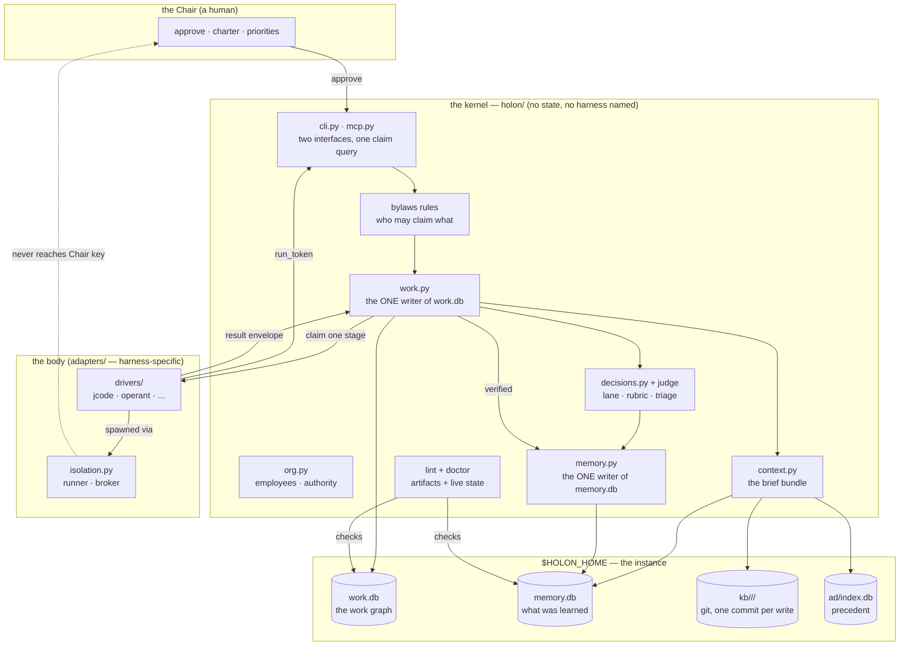

# Architecture — the map, and the one diagram nothing else carries

This directory is the **map** of the documentation, not a duplicate of it. `docs/ARCHITECTURE.md`
already answers "how does the kernel work" better than anything written here could; `docs/BYLAWS.md`
owns roles, profiles, lanes, routines, isolation and the learning loop; `docs/CONTRACT.md` owns the
harness contract. A second copy of any of those would be drift, and this repository has a lint pack
that exists to catch exactly that.

So this directory holds only what no single law doc carries today: **one diagram spanning every
layer**, and the two answers that are asked in this order and currently answered scattered across
six files.

## Which document owns which question

| You arrive asking | Go to |
|---|---|
| "what is this, and what does it believe?" | [`docs/INTENT.md`](../INTENT.md) |
| "how does the kernel fit together inside?" | [`docs/ARCHITECTURE.md`](../ARCHITECTURE.md) |
| "what may this role do, and what does this config key mean?" | [`docs/BYLAWS.md`](../BYLAWS.md) |
| "I am writing a harness — what must I honor?" | [`docs/CONTRACT.md`](../CONTRACT.md) |
| "what command does X?" | [`docs/COMMANDS.md`](../COMMANDS.md) |
| "why is this not a task runner with agents?" | [against a task runner](against-a-task-runner.md) |
| "how does it actually get smarter?" | [the learning organization](the-learning-organization.md) |
| "how does an agent get contained, and why is it off by default?" | [the trust boundary](security-and-trust-boundary.md) |
| "where did this repo's reasoning happen?" | [`docs/design/`](../design) (dated records) |
| "what did the Chair ratify?" | [`docs/decisions/`](../decisions) (AD records) and [`docs/RECORDS.md`](../RECORDS.md) |

## The whole system, in one picture

`docs/ARCHITECTURE.md` diagrams the kernel's internals, the work graph and the trust boundary
separately. This is the one diagram that shows all three at once, because the interesting question —
"where does a turn of work actually go?" — crosses all three boundaries.

Reading it in one line: **the Chair approves, the bylaws decide who may claim, `work.py` is the only
writer of the graph, a body does one stage in an isolated process, and the verified result goes back
into memory — which the next body's brief reads.** Everything else in the system is a refinement of
one of those five steps.

## The claim path, precisely

The single most important line above is `RULES --> WORK`. A claim is one transaction, and it is where
every gate in the system meets: what roles may perform the stage (`BYLAWS.md` §1), whether anything
blocks the work, whether the run's lease is live, whether a fake stage would otherwise be recovered
(`CONTRACT.md` §4), and (since 2026-10-25) whether an employee who may claim it exists at all
(`schedule.unstaffed`, `classes.unstaffed`).

That is why both interfaces confine themselves to the same claim query: an interface cannot grant
more than the graph allows, so the MCP server and the CLI are peers rather than two authorities.

## What this directory is not

- **Not a spec.** Interfaces are exact in `CONTRACT.md` and `BYLAWS.md`; when the two disagree with
  a page here, they win and the page here is wrong.
- **Not a duplicate.** Every chapter above cites the law doc that owns its detail rather than
  restating it.
- **Not a changelog.** What was decided and when lives in dated `design/` records; what the Chair
  ratified lives in `decisions/`. Neither is edited in place, and neither belongs here.
