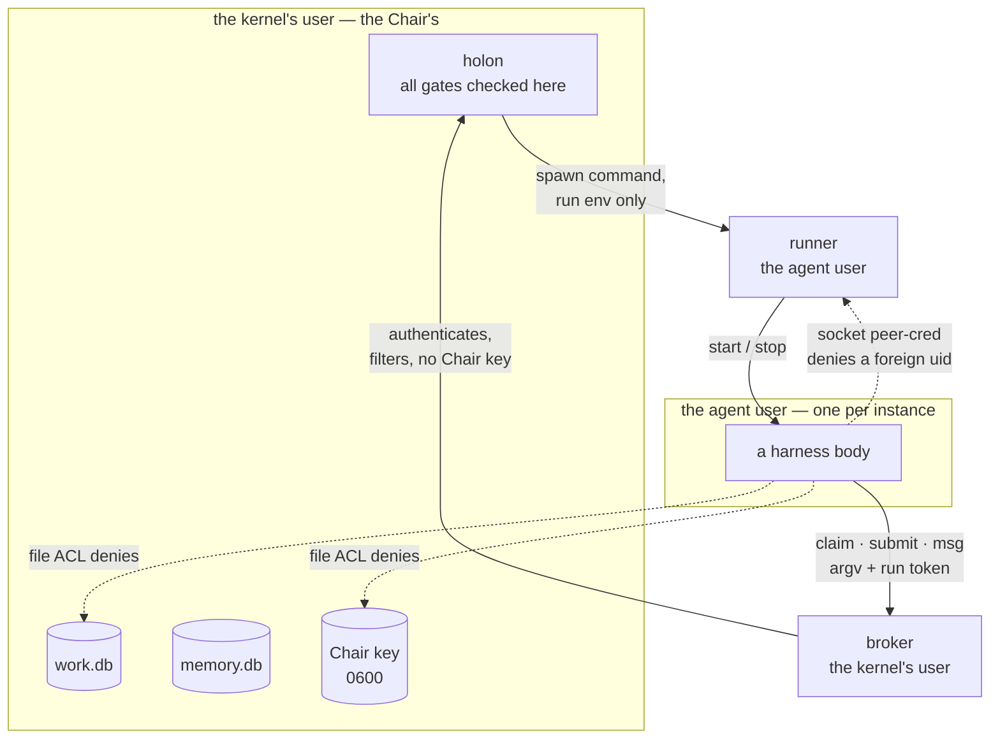

# The trust boundary

`docs/BYLAWS.md` §11 states the configuration; `docs/CONTRACT.md` §6 states what a harness must
honor; `docs/ARCHITECTURE.md` diagrams the topology. This page makes the *argument*: why the boundary
is shaped the way it is, why it is off by default, and what each of its parts actually buys.

For the exact keys and the setup sequence, read `docs/BYLAWS.md` §11. Nothing here repeats them,
because a config table that exists in two places is a config table that drifts.

## The problem it solves

Every gate Holon enforces — run tokens, separation of duties, grade routing, task classes, the scope
fence — is checked **inside the `holon` process**. That is sound as long as the attacker is outside
that process. It is worthless if the adversarial agent *is* the user the process runs as: a body with
a shell, running as the kernel's user, can read the Chair key and write `work.db` directly, and no
amount of in-process checking helps.

So the design assumption is: **a body is untrusted code with a legitimate, valid run token.** Not a
malicious outsider that failed authentication — an authenticated participant that may still try to
exceed its mandate. That single assumption is what the whole boundary buys.

## The shape, and what each part costs the attacker

| Part | What it denies an authenticated body |
|---|---|
| **the broker** | opening the databases at all: argv and run token travel over an abstract socket, and the broker never takes `--home` from the caller and never reads a file the client did not send — so no path-escape trick reaches a file through the kernel |
| **the runner** | inheriting the kernel's environment: the runner passes the body *exactly* the environment of that run, which is what stops a supervisor's credential from reaching the agent process one layer down |
| **peer credential checks** | impersonation: a foreign uid is refused on the socket, so the boundary survives a body that guesses a token's *socket* rather than its value |
| **the ACL plan** | lateral reach: the agent traverses only the directories leading to its own trees, so "read a file by guessing its path" fails before any kernel check is consulted |
| **the run directory** | tampering: sticky, owned by the kernel, with the agent granted by ACL — it reads its brief and writes its result, and cannot replace what the kernel wrote |

The order matters. The ACL is the outermost fence, the broker is the next, and the in-process gates
are the innermost. An agent that beats one still meets the others; that is the point of three
independent mechanisms rather than one strong one.

## Why it is off by default, and why that is not a loophole

Three reasons, all engineering rather than ideology:

1. **Root is the enrollment.** Creating the agent user and its runner service is a root operation.
   A distribution that silently mutated the host's user table at install time would be a worse
   product than one that prints a plan and waits.
2. **The plan is a function of instance state.** `holon isolation plan` renders the exact ACLs for
   *this* instance's scope roots and harness trees. Running it before the instance's shape settles
   produces a plan that is wrong the moment a department is added — so the boundary is configured
   after, not before.
3. **An absent boundary is an error, not silence.** `holon doctor` reports `isolation.off` as an
   error, and the heartbeat turns `doctor` errors into incident work. So an instance running without
   it is *reported*, every two minutes, until somebody closes it — by running the plan.

That last point is the load-bearing one. Off-by-default is safe only because it is loud and
persistent, and because the mechanism is reachable in one `sudo sh` of a script the kernel writes to
a durable path (`$HOLON_HOME/isolation/setup.sh`, since a `/tmp` script silently rotted on a Chair
once and nothing noticed for days).

## The four defects that were measured closed

The boundary's *topology* above has been stable since it was designed. What was broken, and was
fixed with guards, was the fine print — each one a place where the design said one thing and the code
did another:

| Defect | Why it mattered |
|---|---|
| the runner merged **its whole inherited environment** over the run's | the promise was "only the run's environment, never the kernel's" — the runner branch was the *less* filtered of the two, so credentials reached the agent one layer down even as the non-isolated path dropped them explicitly |
| `reach()` granted the harness launcher but **not the payload beside it** | a 505-byte launcher next to a 171 MB executable it `LD_LIBRARY_PATH`s to: the boundary closed around a department and the department could not start its own harness |
| an absent boundary was a **warning** the heartbeat never escalated | a live instance whose agents ran as the kernel's user — any one able to read the Chair key — signaled nobody, unattended |
| `isolation plan` refused to run from the state it exists to fix | the documented sequence (plan → `sudo sh` → apply → broker → doctor) was broken at step 1: it demanded an `agent_user` before it could tell you which user to create |

The pattern worth noticing: each defect was the boundary failing **in the direction of being
invisible** — a missing ACL nothing reported, a promise the document made and the code didn't keep.
The guards are named in the repository's regression ledger, and each was verified by mutation: revert
the fix and the guard fails.

## The one honest limit

The trust boundary contains the *body's privileges*. It does not contain the *model's* judgment: a
body with a legitimate mandate can still send a well-formed, in-policy request that is wrong in
intent. That is what the rubric, the gold standard and the verifier are for, and it is a different
problem with different tools. Claiming the Unix boundary solves it would be overclaiming.

## See also

- `docs/BYLAWS.md` §11 — the keys, the setup sequence and the ACL semantics.
- `docs/CONTRACT.md` §6 and §10 — identity, and `policy.json` and refusals.
- `docs/ARCHITECTURE.md` — the trust-boundary diagram in kernel context.
