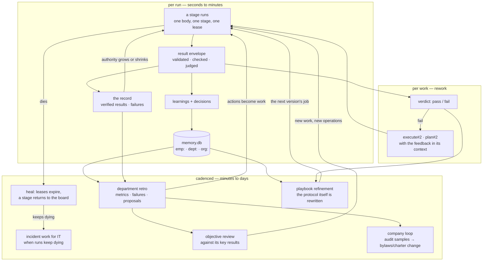

# The learning organization

This page is the answer to the question the README makes in one line and no single document answers
end to end: *every piece of work leaves the organization smarter.* How, precisely, and at what
cadence.

`docs/INTENT.md`'s feedback-loop table is the authoritative list. This page joins it into one
narrative, because the loops only mean something together — a learning that cannot be *found* by the
next body did not happen, and a metric nobody reads is not a sensor.

## The six loops, as one system

## Loop by loop

### Employee — every run

Every stage's result carries `learnings` and `decisions`. They consolidate into that employee's own
`emp:` scope, and — the step that makes it collective — lessons that recur across colleagues
**promote** into the department scope (`Memory.consolidate`, `Memory.promote_recurring`). Promotion
is counted, not narrated: a lesson that appears once stays personal.

The same run updates the employee's **record**: verified results, failed verifications, plans approved
first try. That record is what review reads and what earned authority is computed from
(`holon hr review`, `Org.earned_authority_change`).

### Work — on a failed verdict

A verifier or the gate refuses a result, and the stage returns as `execute#2` or `plan#2` with the
feedback already in its new context bundle. This is the tightest loop and the most important: the
rework body reads what the previous body got wrong before it starts (`Work.verify`).

### Heal — minutes

The lease sweep finds a run whose heartbeat stopped, returns its stage to the board, and — when a
stage's runs keep dying or failing — opens incident work for the IT department rather than retrying
forever. A dead harness reads as a dead harness, not as quiet work waiting.

### Department — on failure, and periodically

The retro is the department's own review of itself: metrics past their bound, failures, colleagues'
proposals, and audit samples. Its **actions become work**, not notes — that is what makes it an
actuator rather than a retrospective.

### Playbook — per job, after verified runs

This is the loop that makes the system self-evolving rather than self-tuning. Judgments per criterion,
verifier failures and judge/verifier disagreements accumulate for one job. When they cross a
threshold, refinement work opens that rewrites the **protocol and rubric** as a versioned department
skill. The next version is itself judged on the same criterion — so a playbook cannot get worse
without it being measured.

### Objective and company — the longest cadence

An objective is decomposed into work and operations and reviewed against its key results until met.
The company loop — on request — takes department metrics and audit samples and produces bylaws and
charter changes, **approved like any other work**. The organization changes itself only through its
own pipeline (INTENT design law 6).

## Why recall is part of the loop, not a feature

The loops above all *write*. Learning that cannot be read back is storage, not intelligence. Two
surfaces close it, and both are budgeted parts of the context bundle rather than optional tools:

- **The bundle** (`context.py`) — the role, the work and why it matters, earlier stages' outputs,
  department memory, lineage and, since K4, each bound knowledge base's wake text.
- **Joined recall** (`holon recall`) — one deterministic answer fusing memory, episodes, skills,
  playbooks and verified results. Its cross-scope floor is deliberately enforced: cross-scope recall
  was once the bundle budget's first casualty, crowded out by large stage material, and the gaps block
  now leads instead of trailing so an agent learns what it never got.

## What the loops are not

- **Not unmeasured.** Promotion, reviews and retros count. Design law 5: learning is measured, not
  narrated, and each metric is paired with a counter-metric.
- **Not unsupervised.** Playbook refinement actions enter work with the same grading and approval as
  anything else. The organization changes itself through its pipeline or not at all.
- **Not a claim about live results.** This page describes the mechanisms and cites them; the numbers
  they produced on any particular instance belong to that instance's evidence, not to the
  distribution.

## See also

- `docs/INTENT.md` — the authoritative loop table and the design laws.
- `docs/BYLAWS.md` §12 — playbooks, refinement and objectives as configuration.
- `tests/test_loops.py` and `tests/test_playbooks.py` — the loops as executable specification.
