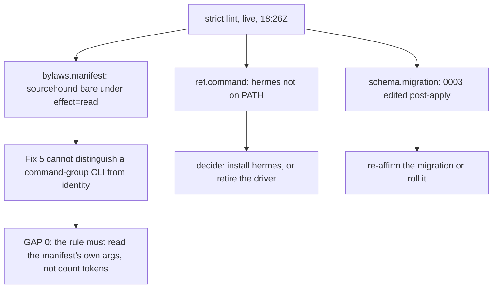

> **Superseded 2026-10-25** by `2026-10-25-remaining-gaps-outline-plan.md` (the universal successor in the
> public distribution). Every row there was re-measured the day after this record's own audit; two
> pre-existing lint errors closed, the staffing red-team landed and changed the plan's own gates, and
> the install-time lifecycle landed so A1's step 0 can no longer rot. This record is the
> operator-context original, unedited past its status line.


# 2026-10-24: the execution order for the remaining gaps, and the row the re-measurement added

Status: **proposed outline-plan**. Scope: A only. Every number below was re-measured at
**2026-10-24T18:26Z** on the live instance (`~/holon`, read-only unless stated) rather than copied
from the 14:12Z gaps record, because that record's own lesson is that a Tier claim carries its
measurement date. Where the two disagree, both are named. Nothing here is about the other stack.

---

## 1. Where it stands, re-measured

| | 14:12Z record | 18:26Z re-measured | delta |
|---|---|---|---|
| doctor | 1 error, 0 warnings | **1 error, 0 warnings** — `isolation.off` (re-measured 19:53Z after the skill-export refresh; the transient warning is recorded below) | unchanged |
| strict lint | 0 errors, 0 warnings | **2 errors, 1 warnings** at 18:26Z; **the `bylaws.manifest` one is closed and re-measured away at 19:38Z** | **was new, now partly closed** |
| employees | 7 active, all `operant` | 7 active, all `operant` | unchanged |
| jcode runs, all time | 0 | **0** | unchanged |
| agent runs since 2026-10-21 | none | **none** (last: `operant`, 10-21T18:03) | unchanged |
| `wake` schedules | none | **none** | unchanged |
| recurring routines | 2 off (past `next_run_at`), 1 on | **2 off (past), 1 on** | unchanged |
| waiting stages | 3 (2 retro, 1 research) | **2 open parents + 3 ready stages** (2 retro, 1 research) | unchanged |
| chair channels | telegram configured | **telegram configured** | unchanged |
| `Auth.channel_principal` | absent | **absent** (guard skips) | unchanged |

So the headline of the gaps record holds exactly: **the engine runs, and nothing dispatches.** The
delta that matters is the lint row, and it is a consequence of my own capability-layer work landing.

**One more consequence of this week's work, found by re-measuring the doctor rather than trusting the
row.** At 19:51Z the live doctor read **1 error, 1 warning** — not the 0 warnings this table carried.
The warning was `skills.export_stale`, naming `holon-planner/briefs/plan.md` in two adapter homes,
and the cause was this week's own Fix 4: attack 3 taught that brief to declare `reads`, and the
brief is a *rendered* skill, so the live instance's exported copies went stale the moment the
library file moved. Fixed with `refresh_skill_exports()`, after which the doctor is 1 error / 0
warnings again. Two things worth recording because they are not what the warning says: the refresh
rewrites **62 files across two adapter homes** (`adapters/jcode` and `adapters/operant`, 31 each),
not the 2 the warning names, because it re-renders the whole export rather than the differing file;
and a skill edit in the repo silently degrades the live doctor, which is the sort of consequence
that only shows up when someone re-runs the command.

---

## 2. The correction this re-measurement produced: strict lint is 3/1, not 0/0

Not a regression in the measurement — a real change since 14:12Z. Exactly one of the
three errors is **the capability layer's rule firing on a live surface**; the other two predate it:

| error | what it is | verdict |
|---|---|---|
| `bylaws.manifest` — `browser.toml`: `sourcehound` declares `effect=read` with the bare `sourcehound` | **Fix 5, landing on a real surface** | **False positive. CLOSED 2026-10-24T19:11Z (`fcfd820`), re-measured away at 19:38Z.** See §3. |
| `ref.command` — driver `hermes`: `hermes` is not an executable on this machine | pre-existing miss | honest; hermes is genuinely not on PATH and its 28 runs ended 2026-10-14 |
| `schema.migration` — `memory/0003_api_memory.sql`: edited after it was applied | pre-existing miss | honest; a migration was touched post-apply |

That table is the 18:26Z reading as measured, and the heading's **3** is kept because it is what the
re-measurement found and it named Gap 0. Live at 20:11Z it is **2 errors / 1 warning** with
`sourcehound` gone, and the rule that closed it was red-teamed twice afterwards — see §3's Gap 0
row, which carries both rounds.

**This matters for the outline's honesty.** The capability-layer plan's acceptance criterion caught
my own identity manifest (a bare `identity` under `effect=read`) and I narrowed it to `identity get`.
The same defect class has now surfaced on the browser surface, which is the strongest possible
signal that the rule was written for *one* binary's shape and not for command-group CLIs in
general. **The plan's row 0 was the generalization, and it is done: `fcfd820`.**

**Why the fix is a rule change and not a manifest edit, proved rather than assumed.** I read both
CLIs. `identity --help` and `sourcehound --help` each list a subcommand *group* (`identity`:
get/values/set/propose/validate/…; `sourcehound`: mcp/call/news/research/…), so both heads are
group entry points and the two are indistinguishable to the rule as written. The evidence the
manifest already carries is `args`: the browser unit documents
`sourcehound <search|read|news|papers|social> <query|url> [--json]`, which names the verb set the
route may take, while `identity get` hard-codes one verb in the command itself. A route that
documents its allowed verbs in `args` has named them; a bare name with a generic or absent `args`
has not. That is the discriminator, and it is in the manifest rather than in a heuristic about
token counts.



---

## 3. The plan, in tiers

The gaps record graded the work A–E and ordered it in six steps. That ordering is kept; what is
added is **Gap 0**, which did not exist when the record was written because it was created by the
record's own predecessor landing.

| # | Gap | Fix | Gate (a command) |
|---|---|---|---|
| **0** | Fix 5's rule fires on a command-group CLI (`sourcehound`) | **DONE 2026-10-24T19:11Z, `fcfd820`.** The rule now reads the manifest: a **bracketed** `|`-alternation in the service's `args` — `<a|b>` or `[a|b]` — exempts a bare command, because that alternation is the verb set the route may be given. A bare name whose `args` is absent, or names only flags, still fails, and so does one whose `args` merely *contains* a pipe in prose. **Re-measured live at 19:38Z: 2 errors / 1 warning, the `sourcehound` error gone, because the live instance's kernel IS this working tree.** | `holon lint --strict` reports **0** `bylaws.manifest` errors on the live instance (**met, measured 19:38Z**), and `test_a_read_route_whose_args_name_its_verbs_is_not_refused_for_a_bare_command` and `test_a_pipe_in_prose_is_not_a_verb_set` both fail if the exemption is removed or widened. **Red-teamed twice since, and the second round found the manifest lying (20:13Z, `5c00820`):** `browser.toml` declared `<search|read|news|papers|social>` while `sourcehound --help` lists 34 real groups and all four declared verbs fail on the binary, so the exemption was passing on shape alone; the manifest is corrected and the fixture now carries the measured set (re-applied in `5af526d` after the public sync `f9fb731` reverted it as a whole-file restore). Live `bylaws/units/browser.toml` was also edited directly, so that surface's truth no longer depends on the working tree.
| **A1** | `isolation.off` | `holon isolation plan --write /tmp/holon-isolation.sh`, then **step 1, the root script**, as root (`sudo sh`), then **step 1.5**, write the `[isolation]` block it prints into `holon.toml`, then **step 2, `holon isolation apply --force`** | `holon doctor` prints **no** `isolation.off` |
| **A2** | the broker unit, now that `agent_user` exists | `python3 install.py --systemd` | `systemctl is-active holon-broker-*` → `active` |
| **B1** | no `wake` schedule, so the 7 employees never run | `holon schedule add --as <emp> --kind wake --cron "*/15 * * * *" --stage <stage>` per department | a `ready` stage is claimed inside one cron window; a `runs` row with a real driver appears |
| **B2** | two `off` recurring routines with a past `next_run_at` | enable or delete, one command each | no schedule whose `next_run_at` is in the past |
| **B3** | 3 ready stages nobody claims | one `holon dispatch --as <id> --task <stage>` each, or a cancel with a reason | `ready_stages` counts drop to 0 by disposition, not by timeout |
| **C1** | 0 of 7 bound to jcode, 0 jcode runs ever *(re-measured 2026-10-24T22:16Z: `SELECT driver, count(*) FROM employees GROUP BY driver` → `operant 7`; `SELECT count(*) FROM runs WHERE driver='jcode'` → 0. Confirmed.)* | `holon hr set-driver <emp> --driver jcode --reason "…"`, one reversible employee at a time | one `runs` row with `driver=jcode` |
| **D1** | the inbound authorization seam (`Auth.channel_principal`) | the guard already skips with the finding as its message; build the method it names | `test_an_inbound_channel_identity_can_be_authorized_as_the_chair` **runs and passes**, not skips |
| **D2** | `adapters/telegram/` does not exist | only after D1 | one test crossing the seam with a real `sendMessage` |
| **E1** | the uid decision is unprovable here | closes by A1 creating a real second user | a live broker-mediated run under a real agent user |
| **E2** | `driver hermes` is declared and `hermes` is not on PATH (`ref.command` error) | the Chair's call: install hermes, or retire the driver (its 28 runs ended 2026-10-14 and every employee is on operant) | `holon lint --strict` reports **0** `ref.command` errors, by either route |

---

## 4. The order, and why

```
Gap 0 — DONE (fcfd820) → A1 → A2 → B1 → C1 → B2/B3 → D1 → D2 → E2 (the Chair's hermes call, any time)
```

**Why Gap 0 was first, and why it was not "cleanup."** It was the only row where the defect was
introduced by this week's work rather than found by it, `holon lint --strict` regressed from 0/0 to
3/1, and the surface it broke (`browser`, pooled by `*`) is the one every department uses. Leaving
it would have made every later row run under a lint that reports a false error, which is how a real
error gets ignored. It is now done (`fcfd820`), verified on a scratch instance carrying the live
`sourcehound` service rather than on the live instance, whose own kernel copy would have to move
for its lint number to change.

**Why A before everything else.** Every dispatched body currently runs as the kernel's own user,
which can read the Chair key and write `work.db`. B1, C1 and B3 all dispatch bodies. Dispatching
them before A is what A exists to prevent.

**Why B1 before C1.** A wake schedule is 3 commands and makes the organization self-running; a
driver swap is worth testing only when something actually fires. C1 without B1 is the current
state again: a driver nobody schedules.

**Why D1 before D2.** The inbound seam is what makes a button act. Building the Telegram adapter
before it builds the carrier without the principal.

**Why E is not a row so much as a consequence.** Only a real second user closes the uid question,
which A1 creates.

---

## 5. What is the Chair's, and what is not

**The Chair's, and only theirs:** A1 step **1** (`sudo sh /tmp/holon-isolation.sh` — root, once; step 1.5 is writing the `[isolation]` block it prints, step 2 is `apply`, step 3 is `install.py`), A2
(`install.py --systemd` touches the broker unit), **E2** (install hermes or retire the driver), and
the D2 go/no-go.

**Mine, now:** B1–B3 (configuration + dispatch), C1 (one reversible employee at a time), and
D1 (the method the guard already names). **Gap 0 was mine and is done** — `fcfd820`, verified on a
scratch instance carrying the manifest that regressed it.

**Both:** E1's measurement, once A1 exists.

---

## 6. What this outline does not claim

- It does not claim the lint errors are all mine. Exactly **one** of the three is the
  capability layer's (`bylaws.manifest` on `sourcehound`), and it is a false positive that needs a
  rule change rather than a manifest edit. `hermes` predates this week, and `0003` is a bookkeeping
  miss.
- It does not claim the suite numbers from the gaps record. Those were measured at 14:12Z on a tree
  one session ahead of its commit; the re-measurement here is of the **live instance's** lint and
  doctor, which are different instruments and are named as such.
- It does not resolve the `sourcehound` question by editing the manifest to satisfy the rule. That
  is the same shape as the fixture-bending the capability-layer plan already recorded withdrawing,
  and the manifest is not obviously wrong — the rule is.
- It carries no stack-B numbers. H12's revenue and V-27..V-31 claims are the other program's.

---

## 7. Execution audit, 2026-10-25 (the day after): what was run, what holds, what is left

Status: **measured 2026-10-25T14:11Z–16:31Z, corrected and re-checked through 18:35Z** on the live
instance (`~/holon`) and on both kernel trees (`holon-personal` at `83a9a79` when the audit
began, `f08d62f` at the re-check; public `holon` at `14f8d69`, re-checked at `5b5b367`). Every
row of §3 was checked against its own gate command; the SQL reads were `mode=ro`, but the
probes were not all read-only — `doctor` stamps its own `settings` row (`doctor_ts`), and
`isolation plan` regenerated `~/holon/isolation/setup.sh`, which produced a new doctor warning
(see 7.2). Both disclosures are carried below. The
headlines: **Gap 0 holds; A1–E2 are all still open; nothing in §4's order after Gap 0 has
started.** The only movement since the record was written is the ventures import (26 routine
proposals staged, all unapproved, recorded in STATUS.md) — which changed the ready-stage counts
but not any gate below. Re-measured at delivery time (18:35Z): every verdict unchanged.

### 7.1 Row by row, against the gate

| # | Gate (as written in §3) | Measured 2026-10-25 | Verdict |
|---|---|---|---|
| 0 | `holon lint --strict` reports 0 `bylaws.manifest` errors; both named tests fail if the exemption is removed/widened | **2 errors / 0 warnings**; neither is `bylaws.manifest` (they are `ref.command` and `schema.migration`, the two pre-existing rows §2 predicted would remain). The three named tests pass in both trees (`holon-personal` and public `holon`: `test_a_read_route_whose_args_name_its_verbs_is_not_refused_for_a_bare_command`, `test_a_pipe_in_prose_is_not_a_verb_set`, `test_the_draft_command_can_declare_the_verb_set_the_rule_reads`). Live `bylaws/units/browser.toml` carries the corrected verb set (`sourcehound <web\|news\|reddit\|research\|twitter\|youtube\|finance\|patents>`) | **DONE and holding.** No regression since `5af526d` |
| A1 | `holon doctor` prints no `isolation.off` | **`ERRO isolation.off` present** — agents still run as the kernel's user. No `[isolation]` block in `~/holon/holon.toml`; no agent user (`holon-agent-01m4sf0…`) exists in `/etc/passwd`; `/tmp/holon-isolation.sh` absent (step 0 not run). `isolation plan` still prints the correct 4-step procedure | **OPEN — Chair's, unchanged.** Root script + `holon.toml` block + `apply --force` all pending |
| A2 | `systemctl is-active holon-broker-*` → active | `holon-broker.service` exists in `~/.config/systemd/user/` (file mtime 2026-10-25 06:09 IST; install.py writes this unit only when `[isolation]` agent_user is set, so its presence at that mtime with no `[isolation]` block in `holon.toml` today is not fully attributable — likely residue of the 2026-10-22 isolation attempt H20 recorded, possibly refreshed by a later unit write) but is **disabled, inactive (dead)** | **OPEN, blocked by A1.** The unit correctly refuses to run without `[isolation]`; per install.py, a plain `install.py --systemd` re-run today would *not* even write it |
| B1 | a `ready` stage claimed inside one cron window; a `runs` row with a real driver | **No `wake` schedule exists** (`SELECT kind FROM schedules` → 3 `recurring` rows, 0 wake). The only drivers in `runs` are the kernel's own script-lane firings (last 2026-10-25T06:00Z, `KB count smoke`), plus operant runs that ended 2026-10-21T18:07Z. 7 employees exist, all `operant`; no scheduled body ever fires | **OPEN — mine.** `holon schedule add --as <emp> --kind wake …` per department not run |
| B2 | no schedule whose `next_run_at` is in the past | The two stale `recurring` rows are still there, still disabled: **Disk usage report** (`next_run_at` 2026-10-23T07:00Z) and **Notes digest** (2026-10-23T08:00Z) — both past-due, both unenabled and undeleted | **OPEN — mine.** Not executed. The working command is `holon schedule enable <id>` (`routine` carries no enable/delete verb); measured under the same-day staffing gate (`f08d62f`), both templates are tools-dept, lane `full`, and their enable passes the staffing check |
| B3 | `ready_stages` drops to 0 by disposition, not timeout | **29 ready stages** (`holon status`: `approve=26, research=1, retro=2`). The 3 this record named (2 retro, 1 research — including `Incident: doctor reports isolation.off`) are still ready and still undispatched. The 26 approves are all titled `Routine: <name>` and are the ventures-import proposals from 2026-10-24, which the import's own gate holds for the Chair's per-job approval. Last body dispatch (an employee's run): 2026-10-21; the kernel's own script-lane firings continued daily after that (last 2026-10-25T06:00Z, `KB count smoke`) — the two are different mechanisms, and only the former is B3's concern | **OPEN — the original 3 are mine** ("one `holon dispatch` each, or a cancel with a reason"); **the 26 approves are the Chair's**, a scope change this record predates |
| C1 | one `runs` row with `driver=jcode` | **0 jcode runs ever** (`SELECT count(*) FROM runs WHERE driver='jcode'` → 0); all 7 employees still `operant` | **OPEN — mine, after B1.** No employee was bound to jcode; the driver swap (`holon hr set-driver`) was not executed |
| D1 | `test_an_inbound_channel_identity_can_be_authorized_as_the_chair` runs and passes, not skips | The test **still SKIPS** with the H8 finding as its message; `Auth.channel_principal` does not exist in `holon/execution/security.py` in either tree | **OPEN — mine.** The seam (the method the guard names) was not built |
| D2 | one test crossing the seam with a real `sendMessage` | No `adapters/telegram/` in the kernel (`holon/` or `holon-personal/`), no `adapters/telegram` in the live instance | **OPEN — blocked by D1**, and go/no-go is the Chair's |
| E1 | a live broker-mediated run under a real agent user | No agent user exists; broker inactive; no broker-mediated run | **OPEN — consequence row.** Closes when A1+ A2 + a wake schedule land |
| E2 | `holon lint --strict` reports 0 `ref.command` errors | **`ERRO ref.command` present**: `hermes` is still not an executable on this machine; its 28 runs ended 2026-10-14 and every employee is on operant | **OPEN — Chair's call, unchanged.** Install hermes, or retire the driver |

### 7.2 What else the re-measurement found (not in the record's rows)

1. **The doctor's smoke warnings are two different classes, and the audit itself caused one of
   them.** Fresh doctor readings at delivery time: **1 error / 3 warnings** (the two
   import-added career-pipeline `smoke.check` rows plus this audit's own `scope.stray`, item 2
   below). Earlier in the day the same command read **1 error / 5 warnings**, and the audit's
   first pass recorded that reading as if it were the instance's state. The difference is a
   measured mechanism, not drift: `run_smoke` **inherits the caller's environment**
   (`service._check_env` passes `os.environ` through, minus credentials), and results are cached
   (`[smoke] every_min = 30`). The audit shell's PATH carries no `~/.local/bin` (where
   `cloakctl` lives), so the audit's own first `doctor` at 14:18Z re-ran the `browser:sourcehound`
   probe exit-127, wrote that failure into the cache, and every later audit reading inherited it
   — until the tick's 18:50Z run (systemd PATH carries `~/.local/bin`) overwrote the cache and
   the probe read ok again. Proven three ways: the pre-import cache (2026-10-24T21:02Z) shows
   the probe passing; a fresh smoke run in a full-PATH shell passes (19:38Z); the two-arm
   experiment (probe with `~/.local/bin` exits 0, without exits 127) shows the probe's
   sensitivity, and the tick unit's own PATH lesson (2026-10-23) is the same class.
   **Consequence for the operator: a smoke probe whose result depends on which shell last ran
   it is a flapping gate** — the route is live, the warning is not, and the artifact class is
   `doctor` reading a cache an under-privileged environment wrote. The two career-pipeline
   warnings are the other class and are real: their smoke blocks arrived with the ventures
   import (absent in the pre-import `holon.toml`, present after; first failing in the
   2026-10-25T10:15Z daily cache), they are deterministic (`invariants-clean-job`: real state
   machine violations in the pool's own data; `scanner-active`: `google.auth` missing from the
   system python), and they are B-side pool facts, not A-side rows.
2. **`scope.stray isolation/` is this audit's own artifact, and it is cleaned up.** The
   `holon isolation plan` probe regenerated `~/holon/isolation/setup.sh` — the command's
   documented side effect — creating the directory the warning names; it did not exist when the
   audit began. The script is regenerable on demand from `isolation plan` (A1's own step 0), so
   the audit removed the directory after recording this, restoring the pre-audit instance
   state; a fresh doctor after the removal no longer prints the warning.
3. **The record's own §2 heading named 3/1, and the live reading at this audit is 2/0 — the two
   pre-existing errors are exactly what remain.** The record's §1 table carried 0/0 as the 14:12Z
   reading; its §2 heading restated strict lint as **3 errors / 1 warning** at 18:26Z and
   predicted the `bylaws.manifest` error (Gap 0) would close, leaving `ref.command` (hermes, not
   on PATH) and `schema.migration` (`0003_api_memory.sql` edited post-apply — a checksum drift,
   the count of applied migrations is right). Live today: **`ref.command` and `schema.migration`,
   nothing else.** No new lint errors were introduced by the ventures import (measured
   before/after in STATUS.md's import verdict).
4. **A1 is now the only row that unblocks the whole ladder.** With Gap 0 done, the A1 root step
   is the single Chair action that opens A2, E1 and (with a wake schedule) the org's first
   body-driven run. Everything else in the ladder is mine (B1–B3, C1, D1) and unchanged.

### 7.3 The register of what is left, in execution order

Per §4's own order (Gap 0 → A1 → A2 → B1 → C1 → B2/B3 → D1 → D2 → E2):

1. **A1 (Chair, root)**: `sudo sh` the generated script (also at `~/holon/isolation/setup.sh`),
   write the `[isolation]` block into `holon.toml`, `holon isolation apply --force`. *Gate:
   doctor no longer prints `isolation.off`.*
2. **A2 (Chair, after A1)**: `python3 install.py --systemd` (re-run) → `systemctl --user enable
   --now holon-broker.service`. *Gate: `is-active` → active.*
3. **B1 (mine)**: one `holon schedule add --as <emp> --kind wake --cron "*/15 * * * *" --stage
   <stage>` per department. *Gate: a ready stage claimed inside one cron window; a `runs` row
   with a real driver.*
4. **C1 (mine, after B1)**: `holon hr set-driver <emp> --driver jcode --reason "…"`, one
   reversible employee at a time. *Gate: one `runs` row with `driver=jcode`.*
5. **B2 (mine)**: enable or delete the two past-due `recurring` schedules (Disk usage report,
   Notes digest). *Gate: no schedule with a past `next_run_at`.*
6. **B3 (mine, for the 3 legacy stages; Chair for the 26 approves)**: dispatch or cancel each.
   *Gate: ready counts drop to 0 by disposition.*
7. **D1 (mine)**: implement `Auth.channel_principal` in `holon/execution/security.py` so the H8
   guard runs and passes instead of skipping. *Gate: `test_an_inbound_channel_identity_can_be_authorized_as_the_chair`
   passes.*
8. **D2 (Chair go/no-go, after D1)**: build `adapters/telegram` with a real `sendMessage` test.
9. **E1 (both)**: measure the first broker-mediated run under the real agent user once A1–B1
   land.
10. **E2 (Chair, any time)**: install `hermes` or retire the driver — either route closes the
    `ref.command` error.

*Audit method: every verdict above was measured on 2026-10-25 by running the row's own gate*
*command (or its SQL equivalent) against the live instance and both kernel trees. No gate was*
*read from a record; every number carries its measurement instrument in the row. Four*
*disclosures. (1) The probes were not all read-only: `doctor` stamps its own `doctor_ts`*
*settings row, and `isolation plan` regenerated `~/holon/isolation/setup.sh` — its documented*
*side effect — which produced the `scope.stray` warning the row above carries. The SQL reads*
*were `mode=ro`. (2) A concurrent session committed staffing gates for schedule enables while*
*this audit ran (`83a9a79` → `f08d62f`); the verdicts were re-measured at `f08d62f` and the*
*public tree at `5b5b367`, and no row changed. (3) The B2 fix row was corrected in place: its*
*first draft named `holon routine enable`, a command that does not exist — the working verb is*
*`holon schedule enable` — the same remediation-class defect this repo's ledger already names*
*(a refusal message must name a command that works), caught because the audit re-read its own*
*commands against the CLI before recording them. Every other fix-command in 7.3 has since*
*been verified against `--help` (`schedule add --as/--kind/--cron/--stage`, `hr set-driver*
*--driver/--reason`, `dispatch --as/--task`, `task cancel --note`, `isolation apply --force`)*
*and they are real. (4) The audit's own environment contaminated its first doctor reading —*
*the 14:18Z cache it wrote made `browser:sourcehound` read failed for four hours of audit*
*readings; the verdict rows were re-measured after the tick's 18:50Z overwrite corrected the*
*cache, and no row changed. A smoke result is the caller's environment, which is itself the*
*lesson a reader should take from 7.2.1.*
