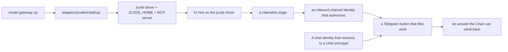

# Red-team audit — jcode plugin integration for agentic workflows across Telegram and the bot interface

Status: 2026-10-24T02:41Z. Both repos synced first (`scripts/sync-public.sh`, `pushed: main personal`),
so everything measured here is the code that is actually deployed. Live instance read `mode=ro`
through `Kernel(home, readonly=True)`, which this same session made honestly read-only. Every claim
below is measured against code, live config, or the live database, and labelled where it is
inference. **Nothing was built: this is the audit.**

---

## 0. The question, precisely

"Red-team the jcode **plugin** integration for agentic workflows across **Telegram and its bot
interface**, for all potential workflows associated with our agentic OS."

Three words in that sentence each carry a finding, and it is worth separating them before
anything else, because two of the three are category errors that would otherwise be reported as
missing work:

- **"plugin"** — Holon has no jcode plugin. The integration is a **driver** (`adapters/jcode/driver.toml`)
  plus an **MCP server** (`holon mcp`, stdio). Measured: `adapters/jcode/` carries `driver.toml`,
  `install.py`, `README.md`, and nothing else. jcode's own CLI (`jcode --help`) has no plugin
  subcommand to register one into.
- **"integration"** — the real seam is narrow and it is the one the README documents: the kernel
  puts `HOLON_RUN_TOKEN` and `HOLON_HOME` in the driver's environment, jcode starts a **stdio MCP
  child** per run, the child inherits them, and `holon_submit` binds to the run. Proved by
  `test_the_run_token_reaches_a_stdio_mcp_server` with a real minted token and the live `mcp.json`
  shape — and famously re-proved after the first probe was false.
- **"Telegram and its bot interface"** — measured: **there is no Telegram path in the jcode
  integration at all, and there cannot be one without a component that does not exist.** This is
  the finding, and it is the same one the Chair-interaction audit reached from the other side.

So this audit is not "what is missing from the jcode plugin". It is: given the seam that actually
exists (a CLI driver + a stdio MCP server, no inbound direction), which of the agentic-OS
workflows are reachable from a chat, which are not, and what the smallest bridges are.

---

## 1. What was measured

| Claim | Measured | Where it comes from |
|---|---|---|
| jcode is one driver among four | `~/holon/config/drivers/`: `claude-code.toml`, `hermes.toml`, `jcode.toml` (2737 B, 2026-10-21 07:43), `operant.toml` | the live instance |
| the MCP surface an agent sees | **56 tools** (`holon_claim`, `holon_submit`, `holon_task_*`, `holon_msg_*`, 5 memory, 4 kb, 4 skill …) | `holon/mcp.py`, `mcp.tools()` |
| a fresh instance's drivers | **`generic-shell` only** — `jcode` is not registerable until `adapters/jcode/install.py` runs | `holon drivers` on a cold instance |
| the live MCP config | `command: <overlay>/bin/holon`, `args: ["mcp"]`, `shared: false`, `timeout_secs: 120` | `~/holon/adapters/jcode/home/mcp.json` |
| the launcher that points at | `PYTHONPATH=$ROOT exec python3 -m holon` — the **overlay's tree**, and after this session's sync that tree's `holon/` is byte-identical to public `main` | `bin/holon`, `git diff main personal -- holon/ tests/` |
| the tool schema cache | 56 cached tools, `fingerprint 18e8d8a6c2696c29`, mtime 2026-10-23 04:49 — **current** (56 live) | `mcp-schema-cache.json` |
| jcode's own inbound surface | none: `jcode --help` lists 40+ subcommands, **no telegram, no bot, no chat, no webhook** | measured |
| the driver's posture | `--no-update --no-selfdev --disabled-tools selfdev,swarm`; README's table matches the installed driver line for line | both files |

---

## 2. The findings

### A1 — "Telegram" and "jcode" meet at **no** point today, and the bridge is the one that does not exist

This is the headline. The audit named the two stacks and asked what crosses them:

| Seam | Exists today | Notes |
|---|---|---|
| Telegram message → kernel | **no** | measured `grep -rniE "telegram\|inline_keyboard\|callback_query" holon/ adapters/`: the kernel carries `chair_channels()` (a *display* of configured refs) and the scrub lint pack's *rules about* chat-id shapes; neither reads a bot. `adapters/telegram/` does not exist |
| Telegram message → jcode | **no** | jcode's CLI has no chat surface; its `serve`/`acp` surfaces are a daemon and an ACP adapter, neither of them a bot |
| Telegram message → an already-running jcode session | **indirectly, and only through the kernel's intent list** | the real route is the one the Chair-interaction audit recorded: someone with the Chair key files work, a heartbeat dispatches a body, the body's result comes back through `holon_submit` |
| kernel → Telegram, outbound | **yes, already, through a different adapter** | `adapters/zeroclaw/` rewires `[notify] command` to `zeroclaw channel send --notify-channel telegram --notify-recipient <chat id>` — a **plaintext one-way** channel, no keyboard, no callback |

**Consequence for "all potential workflows":** every workflow that starts *from* a phone is
blocked at the same place, and it is not jcode. It is the **inbound authorization seam** the
Chair-interaction audit recorded as R2b: no component maps a channel identity (`telegram:<id>`)
to a chair principal, so a bot message cannot authorize anything. jcode is downstream of that
decision, not upstream of it. **Fixing jcode cannot fix this, and fixing this without jcode still
leaves every workflow reachable** — which is the correct order.

### A2 — The outbound Telegram path already exists, in a *different* adapter, and it is one-way

Corrected in place, because my first draft of this table said "no Telegram anywhere". Measured:
`adapters/zeroclaw/` rewires Holon's `[notify] command` to `zeroclaw channel send
--notify-channel telegram --notify-recipient <chat id>`, so **the Chair already receives the
digest on Telegram** through that adapter's transport. What it does not carry — measured on the
live path this session, and the same finding the Chair-interaction audit reached — is a keyboard,
a callback, or any reply: the send command takes a string and posts a string.

That reframes A1 without changing it. The gap is not "no Telegram"; it is:

- **outbound: exists** (plaintext, via a non-jcode adapter),
- **inbound: does not** (no component maps `telegram:<id>` to a principal — R2b),
- **interactive: does not** (no bot-UI primitive anywhere in the distribution).

And it puts the fix's *shape* beyond doubt: the transport that carries the digest today is not
jcode and cannot become jcode, so "the jcode plugin integration across Telegram" is two separate
things — an outbound that already works and an inbound/interactive that is entirely unbuilt.

### A3 — The workflow that *works* today, end to end, measured on a cold instance

Because "no Telegram" is a structural fact about a component that does not exist, the useful
measurement is what *does* work without any chat at all. Measured on a cold instance:

1. `holon init` — one department (`executive`), the Chair key.
2. `holon intake key executive` — **a 36-char chair-keyless credential** (`hik_…`), scoped to one
   department, one grade floor (G1), one set of task classes.
3. `holon task add "audit probe" --intake-key hik_… --intent "claimable?"` — files work, first stage
   `plan`, status `open`.
4. `holon status` — `work: open=1`, `ready stages: plan=1`.
5. `holon doctor` — `graph.unstaffed`: no employee can claim the plan stage.

So the **scanner path is fully wired**: an external system with no Chair key can file work into
exactly one department, and the kernel immediately says whether anyone can do it. That is the
component a Telegram bot should use to *open* work — and it needs no jcode in the loop at all.
Measured caveat, my own error first: I issued `--title` as a flag and got a usage dump. `title`
is positional (`task add TITLE --intent …`); the flag form is my mistake, not a defect.

### A4 — A filed stage waits forever with no employee, and the doctor says so

Same instance as A3: `holon doctor` reports `ERRO graph.unstaffed plan stage tsk_…: no active
employee who can claim it performs 'plan'`. This is correct and it is the *designed* behaviour —
the ledger records `test_a_stage_nobody_can_claim_is_reported_not_left_waiting`. For the
Telegram workflow it means something concrete: **a message that files work buys no work.** The
button that says "give the research department this question" does nothing unless that department
already has a staffed employee on a usable driver, which on a cold instance it does not (A5).

### A5 — `jcode` is not a driver until an installer runs, and the installer needs a model gateway

Measured: `holon drivers` on a cold instance lists `generic-shell` only. `hr hire --driver jcode`
succeeds (the registry does not validate the driver name against installed drivers), but the
instance cannot dispatch on it until `adapters/jcode/install.py` writes
`~/holon/config/drivers/jcode.toml` and the `JCODE_HOME` beside it. That installer requires
`--base-url`, `--model`, and an `--api-key-file` — i.e. **a working model gateway is a
prerequisite for every jcode workflow.** Measured on the live instance (STATUS.md, carried here as
the operator's own record): *the org model-gateway smoke fails — the local free-stack endpoint is
down — every agent waits until it passes.*

So the honest ordering for "operationalize the Telegram workflows" is:

(A5 and A6 in the diagram below are the two unbuilt seams; everything above them exists today.)

### A6 — The live MCP server runs the overlay's tree; after this session's sync that is now also public's tree

Measured: `~/holon/adapters/jcode/home/mcp.json` names `<overlay>/bin/holon`. The installer pins
`REPO/bin/holon`, so the live instance was installed **from the overlay**, not from the public
repo — and `REPO` is `HERE.parents[1]`, which at install time was the overlay checkout.

Why this matters and why it is now safe: the overlay's `personal` branch is permitted to differ
from public `main` only outside the universal file set, and the sync I ran today enforced exactly
that — `git diff main personal -- holon/ tests/` is **empty**, so the `holon/` and `tests/` trees
the MCP child executes are byte-identical to what public carries. Before today's resolution they
were not: the overlay held its own duplicate of the five capability-layer fixes, and the sync's
invariant caught it and stopped with `universal drift on personal`.

**What still does not follow from that:** the overlay is still a *fork*, and the launcher resolves
by `readlink -f` to whichever checkout it sits in. If `personal` ever drifts again in `holon/`,
the live MCP child serves the drift — with no error, because the two trees are the same shape.
The guard is the sync's invariant, which only runs when someone runs the sync. **This is the
finding worth drilling next**: a deployment whose agent surface runs a fork's tree is one
un-synced fork away from serving code nobody upstreamed.

### A7 — jcode's own memory, swarm, ambient and self-update are off, which is correct for the org and wrong for "ambient" chat workflows

Measured in both the shipped driver and the installed live driver: `--no-update --no-selfdev`,
`--disabled-tools selfdev,swarm` on every posture, and the installer writes the config block that
turns off jcode's own memory, ambient mode and telemetry.

This is right for the reason the README gives (the organization's work graph is Holon's; a body
with its own sub-agents or its own memory is a second, unlogged org). It has one consequence for
the question asked: **jcode cannot be the thing that watches a chat and starts work on its own.**
There is no ambient path from jcode to a Telegram message, by design. Any "the bot notices X and
tells the research department" workflow is a Holon routine or a Holon schedule, never a jcode one —
which is the correct architecture, and worth stating because the question's framing ("jcode plugin
... across Telegram") invites the opposite design.

### A8 — The schema cache is current, and nothing would catch it if it drifted

Measured: `mcp-schema-cache.json` carries 56 tools against 56 live, `fingerprint 18e8d8a6c2696c29`,
mtime 2026-10-23 04:49. **The cache is jcode's own, not the kernel's**: `holon/mcp.py` has no
fingerprint concept, and publishes only `serverInfo.version` from `holon.__version__`. So a kernel
change that adds, removes or re-shapes a tool is invisible to the cache until jcode decides to
re-read it, and the kernel has no way to know.

The ledger already carries the shape half of this (`test_the_submit_tool_publishes_the_result_envelope_not_a_free_form_object`,
`test_a_wrapped_list_is_accepted_where_the_contract_says_list`,
`test_a_content_only_proposal_is_repaired_not_rejected`) — those guards make the *published* schema
right. What none of them does is notice a **stale cache on a live instance**, because that is a
property of jcode's disk, not of the kernel's code. Doctor could report it: a `mcp.schema_stale`
check comparing the cached fingerprint to a freshly computed one is a small, honest finding, and it
is the kind of thing that is invisible until an agent calls a tool whose shape changed.

---

## 3. The workflow inventory, honestly graded

"All potential workflows associated with our agentic OS", graded against the seams above. Each
grade names the blocker, so the list doubles as a work list.

| Workflow | Reachable from a chat today? | Blocker |
|---|---|---|
| file work into one department (a scanner's lead) | **yes, already, no chat needed** | none — `intake key` + `task add --intake-key` (A2) |
| see status / the board | not from a chat | `status` is `any`-actor, so a *tool* can call it; the missing half is the channel (A1) |
| approve or reject a plan | not from a chat | the approval path is chair-only and inbound auth does not exist (A1, R2b) |
| answer an employee's question | **nearly**: `msg reply` exists, `pending_for_chair` is folded into the digest | the phone ergonomics and the identity (A1) |
| route work to a specific employee | not from a chat | `task add --assign`, same inbound block |
| give on-the-fly direction (a constraint) | not from a chat | `memory add --pin` is chair-only |
| the bot noticing an event and starting work | not from a chat, and not from jcode either | by design (A6); belongs to a Holon routine/schedule |
| a jcode body doing planned work | **yes** (this is the one fully working path) | needs the model gateway and an installed adapter first (A4) |

---

## 4. What this audit does not claim

- It does not claim jcode is the wrong harness. It is the adopted one, and this audit's own
  dependency on it (the MCP child that serves 56 tools) is evidence for it.
- It does not claim the missing chat surface is jcode's to build. Every blocker above is either
  the inbound authorization seam (a kernel-owned principal question) or the adapter that does not
  exist (`adapters/telegram/`), and law 2 puts both on this side.
- It does not close anything. Two things are measured as **open and unprovable on this host**: the
  uid decision of the trust boundary (only a real second user closes it), and whether a live
  jcode run would authenticate correctly end to end (the free-tier model gateway is down, so no
  body can be dispatched at all). Both are recorded rather than assumed.
- It does not measure the model gateway's health itself; that is reported by STATUS.md as failing
  and is the operator's to bring up.
