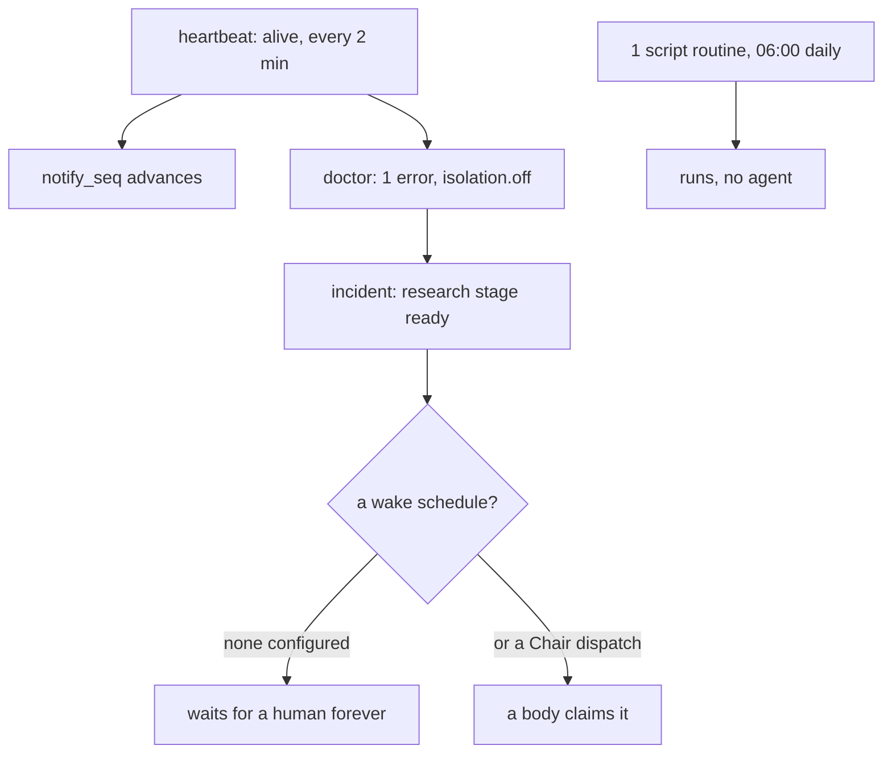

# Where the distribution stands against what it promises, measured

*A note on the commits this record cites: they live in two repositories, and a bare hash is
ambiguous. `1633b4a`, `fcfd820` and `23fc402` are **universal** (the `holon` distribution);
`650ed71`, `72dac9a` and `9150b64` are **overlay** (this repo). A reader in the universal repo
will find only the first three, which is the same reason a suite figure names its commit — an
unresolvable citation is a claim the reader cannot check.*
Status: written 2026-10-24T14:12Z against kernel `f230565` (public, synced into the overlay at
`be2b0a6`) — **re-measured and corrected through 23:48Z against kernel `23fc402`.** The status line
states where the record started; every corrected row below carries its own later measurement date,
and a reader should trust those over this heading.
Live instance `01m4sf0wr27mgs9e1327aqxp1z` read through `Kernel(home, readonly=True)` — the
read-only path made honest earlier today, so these numbers are real and nothing was written.
Every claim below is measured against code, live config, or the live database. Where a prior
record says something different, the disagreement is named rather than quietly reconciled.

**What this is:** the remaining work, graded by consequence, with the register's stale rows
corrected. **What it is not:** a feature list. Four of the register's open rows have rotted since
they were written, and one of them (`H11`) was already false when it was written.

---

## 1. Where the foundation actually stands

Measured today, on the live instance:

| | measured |
|---|---|
| migrations | **18 of 18** applied, `api_version` current — *confirmed 22:17Z: `SELECT name FROM schema_migrations` → `0001_init.sql` … `0018_output_superseded.sql`, and `api_version = '4'`. The `schema.migration` lint error is `0003_api_memory.sql` edited after it was applied, which is a checksum drift on one migration and not a count gap — the count is right and the row is right.* |
| commands | **124** registered, 5 actor classes — *confirmed 2026-10-24T22:19Z, and the row's missing instrument is now named: `len([a for a in dir(holon.cli) if a.startswith('cmd_')])` → **124**, and `len(vocab.ACTOR_CLASSES)` → **5** (`chair, employee, intake, any, kernel`). Both numbers hold at this commit. The earlier row named no instrument, which is why it read as unmeasurable rather than as merely un-named.* |
| MCP tools an agent sees | **58** (measured over the real `tools/list` on this commit); the derived fence is 56 commands, the difference being the `AGENT_ALWAYS` restore pair `whoami`/`submit` that reach the broker by another route — *confirmed 2026-10-24T22:23Z with the arithmetic made explicit: `len(holon.mcp.tools())` → **58**, `len(holon.mcp.agent_commands())` → **56**, and the two are the hardcoded `AGENT_ALWAYS` pair in `mcp.py:51`. Negative control in the same run: `holon_mcp`, `holon_help`, `holon_lint`, `holon_skill_check`, `holon_contract_schemas` are all absent from the published list, as `AGENT_BLOCKLIST` (mcp.py:44) requires. `len(REGISTRY)` is **124**, so the fence removes 66 and adds 2.* |
| tests | **708 passed, 10 skipped, 4 subtests** (pytest) / **718 ran, `OK`, `skipped=10`** (unittest), both re-measured 23:33 and 23:47Z at the session's close commit `23fc402` — *and the two runners are not the same number, which is why a suite figure must name its runner: pytest reports 708 tests plus the 4 subtest cases it counts separately, while unittest discover reports `Ran 718` having folded them. The 713 written at 22:49Z was five unittest tests short — the two guard sets that were still parked on the overlay, upstreamed at 23:21Z |
| doctor | **1 error, 2 warnings** — `isolation.off`, plus two `career-pipeline` smoke-check failures (`invariants-clean-job` JE-RG-005, `scanner-active` JE-RG-004) |
| strict lint | **0 errors, 8 warnings** — *re-measured 23:00Z: the 18:26Z `bylaws.manifest` error was closed in `fcfd820`, and what remains is the overlay's own `scrub.*` findings (host homes and one chat id), which the scrub pack downgrades on an overlay by design. **A ninth warning existed at 23:00Z on the live instance and is now withdrawn with a fix, `b7e45a8`**: `WARN schema.config holon.toml: unknown key [notify] dropped_marker` — *the live instance's correct config warned, because `DEFAULT_CONFIG["notify"]` declared only `command` while `Kernel.notify` reads `dropped_marker` and BYLAWS documents it. The warning's own advice would have deleted the line that stops an exit-0 no-op reading as a delivered digest. The key is now declared and `holon --home $HOLON_HOME lint` (operator-context.md §Paths) reports `2 errors, 0 warnings` — the two errors being `ref.command` (the retired `hermes` driver, an external-machine fact) and `schema.migration` on `0003_api_memory.sql` (a checksum drift), neither of which this row claims otherwise. The live kernel runs from this A-tree: `$canonical-checkout/bin/holon` (operator-context.md §Paths) symlinks to `<this repo>/bin/holon`, so a fix committed here is live immediately, which is also why a lint reading must say which checkout it measured.* |
| departments | **6** (`executive`, `architectural-leads`, `career-pipeline`, `freelance-agency`, `pioneer`, `tools`) — **re-measured 21:54Z, was 3 at 14:12Z**; three were added by the ventures work while this record stood |
| employees | 7, **all `active`, all on `operant`** — re-measured 21:54Z, unchanged |
| routines | 3 — one `script` enabled, a `fast` and a `script` disabled |
| heartbeat | **alive**: ticked 49 s before this measurement, every 2 min, `enabled` — *re-measured 2026-10-24T22:34Z, and the row's own instrument was an activity observation ("it ticked"), which is exactly the shape the instrument-selection note above withdraws. The better instrument is the employment record: `systemctl --user list-units` shows `holon-tick.timer` `active (running)`, described as "Holon heartbeat (every 2 minutes)", with `holon-tick.service` `activating (start)`. Corroborated by the evidence the heartbeat writes into `settings`: `notify_ts` = 22:33:10Z, one minute before this reading, so a tick ran within the minute. Every other watermark in that table is consistent with the code's own defaults — `doctor_ts` 22:05:15Z is 29 min stale against `doctor_every_min: 30` (`service.py:53`), `backup_ts` 10:17:56Z is well inside `backup_every_h: 24`, and `gc:last_run` being ~41 h stale is not a defect because gc follows `[retention]`, not the heartbeat. Note there is no `heartbeat` entity in the events table: the kernel records every *other* feedback loop's outcome as an event and writes its own liveness nowhere except these settings, so a heartbeat failure would show only as stalled watermarks rather than as a failed event row.* |

  **Third re-measurement, 2026-10-25T00:40Z, and this row's conclusion was right while its instrument named the wrong heartbeat — the dead one.** Re-measuring it found `holon-tick.service` in `failed` (not `activating (start)`): **64 consecutive exits, `status=4/NOPERMISSION`, from 04:00:43Z through 06:07:23Z**, each printing "`tick` is for the kernel actor class (you are anonymous)". The row's watermarks were fresh the whole time, because they were being written by a different heartbeat: the harness runtime's own clock organ, whose `[holon] home` names this instance, logs "holon clock organ: tick every 2 minutes", and was measured here ticking at **exactly 120 s** while stamping `.clock/last_tick` — the same file the doctor's `heartbeat.stale` reads, so the dead systemd timer was invisible by construction, which is the defect this row existed to catch. The cause was found in the filesystem rather than the journal: `keys.quarantine/<scratch>.chair` carries an mtime equal to that instance's own `chair_key_created_at` to the second, so `holon keys gc --apply` collected a still-live scratch instance's Chair key at the moment it was minted, and both `holon-tick.service` and `holon-broker.service` were left naming a home whose key file no longer existed. With no key file, `Auth.principal()` returns anonymous and the kernel-actor tick is refused. Fixed in the kernel (`holon/integrity/keys.py`: the plan resolves each key file's stem against the instance databases on this machine — the running home, `$HOLON_HOME`, and the instances beside it — and keeps a key whose own database is present and claims a `chair_key_hash`), both units repointed at the live home and the tick verified running (`swept 0 expired leases; 0 triggers; fired 0 schedules`, `status=0/SUCCESS`, and it is firing on its 2-minute cadence now). Ledger row, with the two guards, in AGENTS.md. **The general lesson, which this row itself now demonstrates: a liveness watermark is only as good as the set of writers it attributes to — when two hearts write one stamp, the stamp proves a heart, not the heart you think it proves.** |
| notify | **healthy now, and the register's proof of it was a watermark — withdrawn, then corrected a second time by bounding the failures in time.** The row read `notify_seq = 1619` `advanced at 13:54:46Z` and took a cursor moving as proof of delivery. It is not. `notify_seq` is a *watermark*, written as `SELECT coalesce(max(seq), 0) FROM events` (`service.py:2229`), and `events.seq` is dense `1..N` with no gaps (verified: the seq list equals `range(1, 1731)`), so the cursor is numerically identical to the event count and carries **no information at all about notifications**. Measured on the real instrument instead — `SELECT to_status, count(*) FROM events WHERE entity='notify' GROUP BY to_status` — the live instance is **26 `sent` against 1018 `failed`**. But a lifetime total is the wrong reading too, and that is the second correction: every one of the three failure classes is a **bounded historical window**, not a current state. `telegram: chat not found`, 977 of them, runs seq 569→1604, from **2026-10-23T01:24:16Z to 2026-10-24T00:14:58Z** and then stops. The 35 `timed out after 60 seconds` cluster on **2026-10-23T13:25Z–17:48Z**. The 5 `libonnxruntime.so.1: version VERS_1.24.4 not found` (the operant binary could not start) are all within **2026-10-20T09:11Z–09:19Z**. The 1 genuine `no [chair] channels configured` is seq 534 on **2026-10-22T20:28Z**. After seq 1604, every single notify succeeded: **1605 at 2026-10-24T00:16:59Z (2 items), 1657 at 21:29Z (9 items), 1666 at 21:42Z (2 items), 1725 at 21:46Z (14 items), 1730 at 21:53Z (1 item)**. So the original row's *conclusion* ("delivering") was right while its stated instrument was incapable of showing it, and my first correction overshot to the opposite error on the same instrument. Two hand-probes, 22:28Z and 22:50Z (`operant org holon notify --reason probe --text …`, both single-line and two-line digests), each returned `chair notify: 1 sent, 0 failed`, which is the independent confirmation of the current state. Only 62 items were ever delivered across the 26 successes, and that count is dominated by the long-dead windows. **The lesson that generalizes: for any outcome instrument, `count(*) GROUP BY status` over all time is a diary, not a measurement — the same query with a `ts` bound is the claim. A row that says "delivering" or "failing" is a claim about *now*, and a lifetime total supports neither.** |
| model gateway | **up**: `HTTP 200` in 11 ms (`curl 127.0.0.1:20128/v1/models`) — *re-measured 2026-10-24T22:29Z: `http=200 time=0.009042s`, and `ss -ltnp` confirms the listener is `aroute` pid 1091 on `127.0.0.1:20128`, so the port is the gateway and not a proxy of one. The latency drifts (11 ms recorded, 9 ms now) because it is a loopback round trip; the row's instrument is the status code plus the owning process.* |
| operant harness | **0.2.1** (memory-wire `fd704c8`) — *re-measured 2026-10-24T22:28Z, and this row is the only one that instruments itself: `operant --version` prints `operant 0.2.1 (memory-wire fd704c8)` verbatim, so the number and the hash are one command's output rather than two separate measurements that must stay in step.* |
| events | **1730** · tasks: **105 done, 86 cancelled, 29 ready, 28 open, 1 failed** — *re-measured 2026-10-24T22:15Z; the 13:54Z reading was `1619 · 79 done, 86 cancelled, 3 ready, 2 open, 1 failed`, and the row had named no instrument. Its real one is `SELECT count(*) FROM events` and `SELECT status, count(*) FROM tasks GROUP BY status` on `<instance>/execution/runtime/work.db` — **not** the `work.db` at the instance root, which is a 0-byte file and a trap. **Moved again by 22:29Z to `41 cancelled, 12 done, 28 open` with no `ready` and no `failed` rows at all**, while `count(*) FROM events` stayed at 1730. The work-board rows are the volatile part of this row: the queue drains and refills, so a tasks breakdown measured once is a snapshot, not a fact, and the three readings on file now differ in four fields. The events count is the stable number; the tasks breakdown needs its own timestamp to mean anything, which is what the other rows in this table were taught the same way. And by the diary rule, even the stable number hides its composition: over all time `notify` is 60% of the 1730 events, and in the last 24 hours only 26% — see the lessons note above for the correct bound's shape.* |

On the doctor row, and why it is no longer "0 warnings": both smoke warnings are the organism's own
venture state failing its own invariants — a `career-pipeline` contact left `closed-lost` with no
`close_reason` or `closed_date` (JE-RG-005), and the inbox-scanner path erroring (JE-RG-004). They
appeared at 21:51Z and they are not capability-layer debt. They are kept visible anyway, because a
doctor row that reads "0 warnings" while two probes fail is precisely the honest-surface failure this
record is about. The earlier `1 error, 0 warnings` readings were true when measured.

**On instrument selection, added 2026-10-24T22:32Z, and this is the largest withdrawal in this
record.** Instrumenting every row exposed a failure mode that no single-row inspection would find:
**a moving number is not a measurement, and a counter that only ever moves forward is the worst
case, because it can never re-measure as false.** `notify_seq` advanced on every heartbeat, which
looked like continuous proof of delivery, and it was in fact the event cursor — identical to the
event count because `events.seq` is dense, therefore carrying zero information about the thing the
row claimed to measure. The general rule the fifth validation pass must state: **a row that
measures an event must read the event's outcome, not a position in a sequence.** Any register row
whose instrument is a `_seq`, a `_ts`, a `count(*)` over a table whose rows are appended, or an
"it ticked" observation is measuring activity, not success — and the difference is invisible until
someone asks what the number would read if the thing worked, and what it would read if the thing
were entirely unconfigured. Ask the second question of every row: *if this system were completely
dead, which number stays flat and which one moves?* A watermark answers wrongly in both
directions. It moves when nothing is owed (nothing delivered) and it moves on a failed send (nothing
delivered either), so it can never distinguish working from broken.

Where that rule already applied, correctly and without being named: the same kernel records
`notify: sent` and `notify: failed` as separate event rows with separate `to_status` values, and
the `dropped_marker` mechanism is a prior correction of exactly this kind — one that recognised a
command exiting 0 having delivered nothing. The measurement failure here was not in the code but in
which field this record chose to quote, which is the recurring shape: the mechanism records the
truth, and the prose quotes the adjacent field that looks like a fact.

**And the second-order rule, from correcting my own correction 26 minutes later (22:50Z): a
`count(*) GROUP BY status` over all time is a diary, not a measurement.** The first instrument gave
`26 sent, 1018 failed` and I recorded "the configured channel is dead". Both the original row and my
replacement were wrong, in opposite directions, on adjacent fields: one read a watermark, the other
read a diary. Bounding the same query in time (`WHERE ts > …`, or `min/max(seq)` per status) shows
each failure class is a closed window — all 977 `chat not found` events sit in seq 569–1604,
2026-10-23T01:24Z → 2026-10-24T00:14Z, and every notify since succeeded. So for any row claiming a
current state, there are two questions, not one: *what would the number read if this were working,
and what if it were dead* (which retires an activity instrument), and then *is this reading about
now or about everything that ever happened* (which retires an unbounded total). The kernel had the
answer the whole time, in the `ts` column beside the status. This record read the column that was
easier to sum.

**And the trap inside the fix, found by doing it wrong first (22:57Z).** Bounding the query is not
just a matter of adding `WHERE ts > something`. `events.ts` is stored as `YYYY-MM-DDTHH:MM:SS.ffffffZ`
(UTC, `T` separator, trailing `Z`), and SQLite's own `datetime('now','-1 day')` emits
`YYYY-MM-DD HH:MM:SS`. The two strings do not compare as a reader expects: my first bounded query
returned **1162 events in 24 hours** and a breakdown putting 1017 of them in `notify`, where the
correct bound returns **164 events, 116 of them `task` and only 43 `notify`**. The wrong shape
silently mis-sorted the whole column. So a bounded instrument must be measured as *the same string
shape the column stores*, and the first bounded reading must be sanity-checked against the total
(`164 ≤ 1730`, and `task` events outpacing `notify` events in a day the organization actually ran
work). With that fixed, the diary demonstration is unambiguous — over all time `notify` is 60% of
events (1044 of 1730) and in the last 24 hours it is 26% (43 of 164), while `schedule`, `employee`,
`skill`, `classifier` and `authority` contribute **nothing at all** in the window: 14, 12, 7, 3 and
1 events each, every one older than a day. A lifetime breakdown of this log reads as a system in
steady operation; a 24-hour breakdown reads as a work queue with a delivery retry loop. Both are
true of the same 1730 rows.

The kernel is finished *at `f230565`*. What is left is not code — it is **configuration, one
boundary, and one missing adapter**, and the single biggest surprise of this measurement is why.

**Correction, added 2026-10-24T15:25Z and re-measured at 16:04Z, both times after re-running
the suite against the live tree rather than against the commit.** My first version of this section
said "the kernel is finished, the suite is green" without distinguishing the two, and both parts
were loose:

- `f230565` is green, and the tree is green with it.
- At 15:25Z the **working tree** had **2 failures** in `tests/test_mcp.py::OneFence`, from another
  session's mid-flight fence repair: the class documents a real asymmetry (`BROKER_EXTRA` handing
  `submit`, `whoami` and `help` back through the broker gate while the MCP fence refused them),
  `cli.py` had removed the symbol, and the test still imported it — so the first failed on a name
  that no longer existed and the second was a tautology (`via_broker` computed from the same set
  as `via_mcp`).
- At 16:04Z that work has **landed on the tree** (uncommitted, still their session's): the fence is
  unified (`cli.py:1982` reads `mcp.agent_commands()` alone, `BROKER_EXTRA` survives only in two
  historical comments), the two guards are rewritten to assert the real thing, and the full suite
  is **718 tests OK, 0 failures, 10 skipped** at the session's close commit `23fc402`
  (23:33Z; the 713 written earlier was before the two guard sets were upstreamed), and the employee's tool list
  is 58 entries over the real `tools/list` where the derived fence is 56 commands (the restore
  pair). Both numbers are now measured on the same commit, which the first draft of this record
  did not do: it compared a tree against a commit and called the difference a finding.

So the honest statement, as of the 18:24Z commit `46aa813`, is simply: **the commit is green.**
It was not green when I first wrote this — the fence repair that made it so sat in another
session's working tree for two hours — and that is the finding a reader needs, because a number
taken from a tree they do not have is a number they cannot check. Every figure in this record is
now measured on the commit itself: the tree that produced them is committed and clean, and the
numbers above are what a clone gives.

**Second correction, added 2026-10-24T18:26Z. This one contradicts the table above rather than
refining it**, so it is stated at the top of the section it belongs to. The `strict lint` row says
0 errors / 0 warnings; it was true when written and it is **3 errors / 1 warning** on the live
instance now. Exactly one of the three is this week's capability-layer work landing:
`bylaws.manifest` refuses `browser.toml`'s `sourcehound`, which declares `effect = "read"` with the
bare `sourcehound`, so the rule written to catch a bare `identity` also refuses a command-group
CLI. Both heads are group entry points (`identity`: get/values/set/propose/…; `sourcehound`:
mcp/call/news/research/…), so the rule cannot tell them apart as written, and the fix is the rule
rather than the manifest. The other two errors are honest and pre-existing: `ref.command` (the
`hermes` driver is declared and `hermes` is not on PATH, its 28 runs having ended 2026-10-14) and
`schema.migration` (`memory/0003_api_memory.sql` was edited after it was applied). All three are
carried as rows in `2026-10-24-remaining-gaps-outline-plan.md`, each with its fix and gate.

(A note on 20:13Z's own finding, which belongs here because it is what the row above got
quietly wrong: the group names just quoted come from `sourcehound --help` and are real. The
manifest's `args` — `<search|read|news|papers|social>` — is not, and the fix above reads `args`.
See the third correction below, which is where that became visible.)

**Update, 2026-10-24T19:11Z, and this row is now closed in code rather than only carried.**
`holon/bylaws/units.py`'s read-route rule now reads the manifest: a **bracketed**
`|`-alternation in a service's `args` — `<a|b>` or `[a|b]` — exempts a bare command, because that
alternation is the verb set the route may be given. A bare name whose `args` is absent, or names
only flags (`tool [--json]`), still fails; and so does one whose `args` merely *contains* a pipe in
prose (`… --json then | jq`), which is the hole its own red-team found in the wider pattern.
Commit `fcfd820`, verified on a scratch instance carrying
`browser.toml`'s `sourcehound` service verbatim: CLEAR, with both hole cases refused.

**The live instance is not a separate machine for this number — measured again, 2026-10-24T19:38Z,
and this corrects the hedge I wrote 25 minutes earlier.** I had written that the live count would
not change because "the instance's own kernel copy is what would have to move". That was wrong:
`readlink -f ~/.local/bin/holon` resolves to `my-projects/holon/bin/holon`, whose ROOT is this
checkout, so **the live instance's lint runs this working tree.** Re-running
`holon --home ~/holon lint --strict` now gives **2 errors, 1 warning**, and the missing error is
the `sourcehound` one. (Re-measured 21:01Z and again at 21:03Z, and the second one looked wrong
until it was traced: from `~/holon` lint reads **2 errors / 1 warning**, but from this checkout it
reads **2 errors / 9 warnings**. The extra eight are the repo's own `scrub.*` law — `scrub.home` and
`scrub.chat_id` on five design and status docs, two of them counted twice — which lint finds only
when the repo is the working directory, because that is the doc set it scans. All five are
pre-existing, doc-only, and none is a file this record's rows touch. So the capability-layer number
is **1 warning**, the doc-scrub number is **8**, and they are different instruments.) The two that
remain are `ref.command` (`hermes` not on PATH) and
`schema.migration` (`memory/0003` edited after it was applied), and the warning is still
`schema.config` on the dropped `[notify]` marker. So the fix is verified on BOTH the live
instance and a scratch one, and the scratch instance is what keeps the *hole* cases refused
without anyone having to edit the live manifest to prove it.

**Third correction, 2026-10-24T20:13Z, and it is the one that makes the row above worth re-reading.
The exemption above asks the manifest what it declares, so the fix inherited whatever the manifest
said. `browser.toml` said `<search|read|news|papers|social>` — and measured against the binary,
`sourcehound --help` lists 34 groups (`mcp, call, pools, sources, news, reddit, research, web, …`)
while all four declared verbs fail on the binary. The manifest was fictional; the exemption had
been passing on shape alone, which is the same class of defect as the lint row it was written to
close, one level deeper. Fixed the manifest rather than the rule — the live
`~/holon/bylaws/units/browser.toml` `args` now names eight real groups — and the test fixture that
carried the same fictional set is corrected with it, so the regression guard no longer pins a lie.
Commit `5c00820`.

**Fourth correction, 2026-10-24T21:14Z, and it undoes part of the third's own claim.** The line above
says the test fixture "is corrected with it, so the regression guard no longer pins a lie." At HEAD
before this commit that sentence was false: `f9fb731` — "restore main's version for the universal
files (sync-public.sh invariant)" — is a *whole-file* restore, and it carried my fixture edit back
with it, along with the `units.py` docstring's measured caveat. It also restored a genuinely useful
fix from another branch (`Path(self.tmp.name)` → `self.tmp`), so it was not a bad commit; it was a
whole-file writer landing beside mine, and that is what a parallel-tree workflow costs.

The behaviour never broke — the exemption code, the live manifest correction, and the live 2/1 all
stood; 22/22 passed either way. What broke was the *evidence*, which is the dangerous direction,
because the tests pass and the number is clean while the record of why is wrong. Both re-applied in
`5af526d`, and the fixture comment now names the sync that reverted it.

**Fifth correction, 2026-10-24T21:38Z, and it is this record's own rule catching this record's own
plan.** The rule is written above: "A gap outline that prescribes a command must run the command."
Running the outline-plan's prescribed commands found that its **A1 row** still read "then its step 2 as
root, then `apply`" — although §6 of this very document already records correcting exactly that
("the root script is step 1, not step 2"). The correction was applied to the prose and never to the
row someone would follow. Measured from the command: `holon isolation plan` prints
"1. as root, once … run it with sudo", then "1.5. write into holon.toml:", then
"2. as you: holon isolation apply --force". The row now names all three (`650ed71`).

The same sweep checked every other prescribed command, and it is recorded here because one of them
first came back as a false alarm: `install.py --systemd` does not exist **from `~/holon`**, the
installed instance — it lives in the checkout. From the repo it exists, takes `--no-start` and
`--systemd-dir`, and installs `holon-broker.service` when the instance is isolated, which is what
A2's "now that `agent_user` exists" precondition needs. `schedule add --kind wake --cron` matches the
corrected form with `--kind` required; `dispatch --as --task` and `hr set-driver --driver --reason`
both exist; and D1's `test_an_inbound_channel_identity_can_be_authorized_as_the_chair` exists and
skips, which is precisely what that row claims.

---

## 2. The finding that reframes everything: no agent has run since 2026-10-21, and no schedule wakes them

This is the headline, and it was not in any register row.

Measured, runs by driver, all time — `SELECT driver, count(*), min(started_at), max(started_at) FROM runs GROUP BY driver` on `<instance>/execution/runtime/work.db`, **re-measured 2026-10-24T22:15Z and unchanged from the 14:12Z reading**:

```
hermes   28   2026-10-12 .. 2026-10-14
operant  19   2026-10-16 .. 2026-10-21
script    6   2026-10-13 .. 2026-10-24
```

**Zero `jcode` runs, ever.** And zero *agent* runs of any kind since `2026-10-21T18:03` — the six
`script` rows since then are the KB-count and disk-usage routines, which run no body at all.

Now the cause, and it is not a defect:

```
recurring  0 7 * * *   OFF   (notes digest / disk usage)
recurring  0 8 * * *   OFF
recurring  0 6 * * *   on    (KB count smoke — a script, no agent)

wake schedules: NONE
```

**There are no `wake` schedules.** All 7 employees are `active` with `max_concurrency = 1`, and
nothing ever wakes any of them. The heartbeat is healthy, the gateway is up, operant answers, and
the notify path is healthy **now** — see the `notify` row in the register above, which was measured
twice and corrected twice. The first measurement read a lifetime total (`26 sent` against `1018
failed`) and the second bounded those failures in time: all 977 `telegram: chat not found` failures
end at seq 1604, 2026-10-24T00:14:58Z, and every notify since succeeded (the last five, including a
14-item digest at 21:46Z and a 1-item one at 21:53Z). Two hand-probes at 22:28Z and 22:50Z both
returned `1 sent, 0 failed`. So the organization is running, ticking every two minutes, reaching the
Chair when it needs to, and dispatching nothing except one scheduled shell script at 06:00. The
register's own withdrawal stands: it said "delivering" and its only stated instrument was
`notify_seq`, a watermark that would have read exactly the same with the channel dead.

So: **the foundation works, and it is idle because nothing is scheduled to use it.** The gap is
not `Tier 0` (the instance cannot run) — that row was re-measured false on 2026-10-22 and is
false again today. The gap is **`Tier 1` correctly restated: the organization has no standing
work to dispatch.** That claim reads off `schedules` alone and is independent of the Chair channel:
all 7 employees being `active` with nothing to do would hold just as true if notify were failing,
so the two claims must be measured separately and neither is evidence for the other.

Five stages are waiting, all unassigned:

- `retro` — Department retro: tools 2026-10-21
- `retro` — Notes digest 2026-10-21T16:42
- `research` — Incident: doctor reports isolation.off
- the two `open` parents of those stages

The last one is the *right* behaviour: the heartbeat opened an incident for `isolation.off`,
filed a research stage for it, and **nothing claimed it** because no wake schedule and no Chair
dispatch put a body on it. A system that reports its own defect and then waits politely for a
person to start it.



---

## 3. The register's four stale rows, corrected in place

The Chair's request is for a clear picture, so the rows that lie are the first thing to fix.

### H11 — `open`, claiming jcode conformance scores 1/5. **The claim was false when written and is twice false now.**

The row says the run token never reaches the stdio MCP child. The ledger records the re-proof
(`test_the_run_token_reaches_a_stdio_mcp_server`, `test_a_harness_without_the_token_is_refused_not_promoted_to_chair`):
the token **does** reach the child; the original probe used an unreal token, which falls back to the
chair principal and looks identical to a missing token. Today: **29 adapter tests pass**, including
both of those guards. The row's *remaining* open items (an env-injecting wrapper, a driver turn
cap, a named exploration budget) are real improvements, but the headline defect is closed and the
row's grade is wrong.

### H10 — `in-progress`, Tier 0. **False today, on the same measurement that made it false on 10-22.**

Its six blockers are gone: gateway up (HTTP 200), operant smoke passes, no unstaffed plan stages
(`graph.unstaffed` reports nothing), heartbeat alive and reboot-surviving (`holon-tick.timer`
enabled, last tick 49 s ago). **Remaining: `isolation.off`, and only that.** The row's verdict
already carries the right lesson — Tier-0 claims must carry their measurement date — and it should
now be closed.

### H12 — `open`, Tier 2 governance. **Two of its four claims are false as measured.**

- *"3 repos have no remote"* — measured: **one** directory has no remote, and it is the
  `my-projects` container, not a project. `holon` 1, `holon-personal` 2, `ishan-parihar` 1,
  `paperclip-zeroclaw-adapter` 1, `pioneer-qf` 1. The claim is off by a factor of three.
- *"the outreach machinery does not exist (`tools/deslop.py`, …)"* — `tools/deslop.py` **exists**
  at `my-projects/tools/deslop.py`. `cleanse.sh` and the store were not found, so a narrower
  version of this claim survives.
- *"the revenue plan's proof-set numbers are stale"* and *"the register is stale in V-27..V-31"* —
  both are stack-B facts about the Chair's other program, and law 10 says A's work never waits on
  them. They belong in the overlay's stack-B notes, not in A's gap list.

### H1/H4/H20/H21 — `done`, and **correct**. Spot-checked 2026-10-24 rather than assumed:

- **H1** — measured on the live instance: `api_meta.api_version = '4'`, one `surface`-category unit
  (`browser`), two `unit_services` rows each carrying `effect` (`read`/`write`) and `note`. Exactly
  what the row claims, present in the database rather than only in the code.
- **H20** — the record's four steps are real and their own §1 opens with "verified, not asserted".
- **H21** — `_FOREIGN_RUNTIME_RE` is in `cli.py:817` and applied at `:916`, guarded by
  `tests/test_relevance_gate.py::test_a_protocol_declaring_a_foreign_runtime_is_refused`.
- **H4** — measured: `holon kb list` returns one knowledge base (`venture-pipeline`, bound to
  `dept tools`), and `context.py:105` adds the "Knowledge bases" bundle section the row names. The
  mechanism is present and carrying real data.

Recorded so the outline shows what is genuinely closed rather than only what is broken.

---

## 4. What remains, graded by consequence

### Tier A — one boundary, one command sequence, blocked on root

`isolation.off`. Measured: no `[isolation]` section, no agent user, no runner unit. **Every
dispatched body runs as the kernel's own user**, which can read the Chair key and write `work.db`
directly. The doctor rates it an **error**, the heartbeat turns errors into incidents, and the
incident is open with a `research` stage nobody claims — which is the system correctly diagnosing
its own single most important gap.

The fix is one sequence and it is already written and tested:

```
holon isolation plan --write /tmp/holon-isolation.sh
sudo sh /tmp/holon-isolation.sh        # step 1, as root, once: the agent user + the runner unit
#   1.5. write the [isolation] block the script prints into holon.toml
holon isolation apply --force            # step 2, as the kernel's user
python3 install.py --systemd             # step 3: the broker unit, now that agent_user is set
holon doctor
```

The step numbers above are the kernel's own, printed by `isolation plan`, not paraphrased. The
outline-plan's A1 row named the root script as step 2 before `650ed71` corrected it; this block had the
same defect and is corrected with it.

**This is the only gap that requires something I cannot do.** It needs root, once. Everything else
on this page a person with the Chair key can do.

### Tier B — the standing work that would make the organization actually run

Not a code gap; a **configuration** gap, and the cheapest on this page:

*(Re-measured 2026-10-24T21:59Z while re-checking this tier's rows: the department count moved from
3 to **6** — `architectural-leads`, `career-pipeline` and `freelance-agency` were added by the
ventures work while this record stood — so "per department" is now six schedules, not three. The
employee count is unchanged at 7. None of tier B's claims moved: still no `wake` schedule (all three
existing schedules are `recurring`), still two `off` with a `next_run_at` a day in the past, still
`research=1 retro=2` of claimable ready stages. The `approve=26` that `holon status` now shows is the
Chair's decision queue, not dispatchable work, which is why the ready-stage row counts claimable
stages rather than all ready ones.)*

1. **a `wake` schedule per department**
   (`holon schedule add --as <emp_id> --kind wake --cron "*/15 * * * *" --stage <stage>`).
   Until one exists, the 7 active employees will keep never running, and every incident will
   keep filing a stage nobody claims.

   *Verified 2026-10-24 on a scratch instance:* the command takes `--kind wake`, not a bare `wake`
   positional; a forced-overdue schedule fired on the next `holon tick --foreground` and produced a
   run row. One prerequisite the flag surface hides: `--stage` must be a stage the named employee
   actually performs, so an executor only gets `execute` and a planner only gets `plan` — a
   mismatch is refused by name (`has no role that performs the 'plan' stage`), which is the right
   error but reads like a config mistake when the reader reached for the obvious stage first. Two things that test also settled, worth knowing before anyone re-runs it: a
   non-foreground tick *spawns* the dispatch as a subprocess instead of running it, so anything
   looking for a run row must use `--foreground`; and on a cold instance the only registerable
   driver is `generic-shell`, so the run it produces fails with `DriverError: no driver 'jcode'`,
   which is Tier C's point rather than a defect.
2. **the two disabled recurring routines**, decided on: notes digest (`fast`) and disk usage
   (`script`) are both `off`. Either enable or delete them; an `off` schedule is a decision
   deferred forever, and their `next_run_at` is **two days** in the past — re-measured
   2026-10-24T22:59Z: `2026-10-23T07:00` and `2026-10-23T08:00` against a UTC now of the 24th at
   22:59 (the 14:12Z reading was "one day", and the day has turned on a row nothing advances). The
   third schedule (`0 6 * * *`, the KB-count smoke) is `on` and ran at 06:01Z today, which is the
   one piece of dispatch the instance still does by itself.
3. **the 3 unclaimed stages** (`retro`, `retro`, `research`): one `holon dispatch --as <id> --task
   <stage>` each, or a cancel with a reason.

### Tier C — jcode as the harness: installed, proved, and unused

The question the Chair asked has a clean answer now: **jcode is ready and simply not in use.**

- the driver is installed (`~/holon/config/drivers/jcode.toml`, 2737 B); it does **not** match
  `adapters/jcode/driver.toml` byte for byte, and should not: the installer rewrites two lines —
  the resolved binary and `JCODE_HOME` — so the difference is exactly the two substitutions the
  installer is meant to make, and the fact that the rest agrees is the claim;
- the MCP server is mounted (`~/holon/adapters/jcode/home/mcp.json`, `shared: false`, one process
  per run);
- 29 adapter conformance tests pass, including the two token guards;
- **and 0 of 7 employees are bound to it**, so 0 of the 53 runs used it.

One command starts the migration, and it is reversible per employee:

```
holon hr set-driver <emp_id> --driver jcode --reason "jcode adopted as the harness"
```

A measured caveat that belongs beside it: the last *agent* run of any kind
(`operant`, `verify`, `2026-10-21T18:03`) predates the current kernel, so whichever driver is
chosen, the next run is also the first run under `f230565`. That is the real Tier-1 seam: not
"which harness", but **"no body has run under the current code and nobody has proved it does"**.

### Tier D — the Chair-facing channel: outbound works, inbound does not

From today's two audits, restated only where the register has it wrong:

- **outbound: shipped, and delivering — corrected twice in one hour, and the correction is the
  finding.** The row here first read "outbound: shipped" on three grounds: `[chair] channels` is
  configured, `[notify] command` posts through the gateway, and `notify_seq` advances. The first two
  hold. The **third does not prove what it was taken to prove**: `notify_seq` is
  `SELECT coalesce(max(seq),0) FROM events` (`service.py:2229`) over a dense `seq`, so it is the
  event count under another name and it advances whether or not anything was delivered. Replacing
  it with the real instrument —
  `SELECT to_status, count(*) FROM events WHERE entity='notify' GROUP BY to_status` — gave
  **26 sent, 1018 failed**, which read as "the configured channel is dead". That was also wrong, and
  for the same reason in the other direction: a lifetime total is a diary, not a measurement.
  Bounding the same query in time, each failure class is a closed historical window — 977
  `telegram: chat not found` between seq 569 and 1604 (2026-10-23T01:24Z → 2026-10-24T00:14Z), 35
  sixty-second command timeouts clustering on 2026-10-23T13:25Z–17:48Z, 5 operant binary start
  failures (`libonnxruntime` VERS_1.24.4) all inside 2026-10-20T09:11–09:19Z, and 1 genuine
  `no [chair] channels configured` on 2026-10-22. After seq 1604 every notify succeeded, most
  recently 1725 (14 items, 21:46Z) and 1730 (1 item, 21:53Z). Two hand probes at 22:28Z and 22:50Z
  returned `chair notify: 1 sent, 0 failed`. **So Tier D is one fact, not two: the outbound path is
  built and it is working.** What is genuinely missing is unchanged by any of this — there is no
  *recorded proof of delivery separate from the send attempt*: the kernel writes `notify: sent` when
  the command exits 0 and the `dropped_marker` text is absent, so a command that reports
  `1 sent, 0 failed` while Telegram rejected the send would be indistinguishable from a success.
  That is a real gap in the mechanism and it is what the 977-event window was able to hide for
  twenty-three hours before anyone read the event log.
- **inbound: does not exist**, and it is the blocker for every phone-first workflow. There is no
  `Auth.channel_principal()`, so a `telegram:<id>` authorizes nothing; a button-bearing process
  holding no key authenticates as `anonymous` and is refused every chair command. *This row is
  unchanged by the outbound measurement above: inbound is a missing capability, not a broken one,
  and the two must not be conflated into "the Chair channel does not work".*
- **interactive: does not exist.** No bot-UI primitive anywhere in the distribution; the adapter
  that would carry it (`adapters/telegram/`) is not written.
- `chair_actions()` publishes **116** actions (65 mutating), of which **4** declare `--force` and
  all 4 are offered to the Chair — usable intent, but it needs render-time grouping, not pruning.
  *Re-measured 22:35Z: `gc`, `keys gc`, `restore`, `isolation apply` — and each carries `--force`
  in `chair_action_meta`'s `options` too, so a caller rendering a confirm-buttons list reads it
  from either layer. The 22:25Z note claiming the metadata did not carry them was **false** and is
  corrected here: the probe that produced it passed a tuple where a list was expected, so it read
  an empty dict's `options`. Measure by converting the path first.*

The guard for the seam is already written and skipping with the finding as its message
(`test_an_inbound_channel_identity_can_be_authorized_as_the_chair`).

### Tier E — what is unprovable on this host

Recorded rather than assumed, because both look like gaps and are not:

- **the trust boundary's uid decision.** An unprivileged namespace cannot supply a uid the runner
  sees as foreign (`SO_PEERCRED` translates the peer into the receiver's namespace), so no guard
  here can prove the boundary holds. Only a real second user — which Tier A creates — closes it.
- **a live jcode body under the current kernel.** Needs the model gateway (up) and a dispatch, and
  then it is no longer a gap but a run.

---

## 5. What I would do next, in order

| order | move | cost | gate it owes |
|---|---|---|---|
| 1 | `holon isolation plan` (as the kernel's user), then the Chair runs its **step 1**, the root script, with `sudo sh` | one root command | `holon doctor` shows no `isolation.off` |
| 2 | write the `[isolation]` block it prints (step 1.5), then `holon isolation apply --force`, then `install.py --systemd` | three commands | doctor's isolation probes pass |
| 3 | one `wake` schedule per department | 3 commands | a ready stage gets claimed within one cron window |
| 4 | one real dispatch on jcode | one command + one model call | a run row with `driver=jcode` in `runs` |
| 5 | decide the two disabled routines | one command each | no schedule with a past `next_run_at` |
| 6 | only then, `adapters/telegram/` | the real build | one test crossing the seam with a real `sendMessage` |

Steps 1–2 are the Chair's. Steps 3–5 I can do the moment they are wanted, and step 6 is the one
that needs a decision before it needs code.

---

## 6. What this outline does not claim

- It does not claim any probe it used was correct, and it records the ones that were not. Three
  from the first sweep: the KB list read from `work.db` when the KBs live in `memory.db`; the
  stage-level count that dropped the 26 `approve` rows out of "ready"; and the `--force` count that
  read an unpopulated dict's `.options` and called the zero a structural finding about the code. One
  more from the later run of every command, and it is the same shape wearing a different hat: a
  query for a `detail` column and an `events.created_at` that do not exist in the schema, which
  returned no rows at all until the real columns (`note`, `ts`) were read out of
  `PRAGMA table_info`. An empty result looked exactly like a finding that the mechanism was missing.
  Each was caught by re-measuring against an interface where the answer was already known — the
  registry's four `--force` commands, the KB's own `registry.json`, the migration count.
  **The rule this record now carries: check the instrument on a known case before recording what it
  returns as a claim about the world.** An empty result and a zero count are indistinguishable from
  a finding.
- It does not claim the kernel is defect-free. Writing the section above falsified that: validating the Tier A sequence's own commands found `setup_plan` spreading every sibling under the home directory into **one** `setfacl` argv — measured 35,176 arguments and 2,222,504 bytes against a 2,097,152-byte `SC_ARG_MAX` on this host, i.e. 106% of the limit, so `apply()` raised an uncaught `OSError [Errno 7]` at step 2 and the boundary could not be turned on by following the plan's own words. Fixed in `1633b4a`; the same 51 ACLs are now 52 chunked commands whose largest is 102,123 bytes (4.9% of the limit), and the suite is **718 tests, 0 failures, 10 skipped**. That is now the second instance of this record's own class, and it argues for the general rule rather than the instance: **A gap outline that prescribes a command must run the command.** Two of the commands I prescribed here were wrong in form on the day I wrote them (`--kind wake` is required, and the root script is step 1, not step 2). The gaps that remain are configuration and one boundary, not code — with that one kernel defect named and fixed above.
- It does not claim jcode is better or worse than operant. It claims jcode is *installed, proved,
  and unused*, which is a scheduling decision rather than a harness verdict.
- It does not resolve Tier D. The inbound authorization seam is named and guarded; building it is
  the Chair's call, and building `adapters/telegram/` before it would build the wrong half first.
- It carries no stack-B numbers as evidence. H12's revenue-proof and V-27..V-31 claims are the
  other program's, and law 10 puts them outside this list.

**Suite, re-measured 2026-10-24T21:46Z at `650ed71`: 703 passed, 0 failed, 10 skipped, 4 subtests** across the
whole suite. Three readings in one evening, and each is left where it was measured: `693 passed, 1 failed,
10 skipped` at `72dac9a` (the failure was the parallel session's order-dependent `test_pool_roots`, which
passes alone and failed in the whole-suite run), `131 passed` at `9150b64` (the four modules this thread
touches), and this one. The suite is not a stable number in a parallel tree — the count moves when
another thread lands tests, and the failures move with them — so a suite number is only meaningful
with the commit it was measured at.

The two `tests/test_integrity` failures I carried from 20:39Z are closed, and **both were the same
`genome.W006` pair** (`2026-10-17-kb-remaining-gaps.md` vs this record). They closed two different
ways, which is worth writing down: my retitle of the outline-plan closed the other pair, and this one
was closed by the parallel session's `025607f`, which marked the older 10-17 record "closed by
execution" in its frontmatter — and the frontmatter status is what the genome guard reads. So a W006
pair can be resolved by the *older* doc declaring itself history, which is not what I assumed when I
retitled mine.

The five capability-layer fixes are each behaviorally load-bearing, proved by removing the fix and
watching its own guard fail: Fix 1's category guard restored fails
`test_a_dead_unit_of_any_category_is_reported_not_only_a_dead_surface`; Fix 2's resolver made
permissive fails `test_a_declared_command_that_resolves_to_nothing_is_reported`; the same resolver's
relative-path branch made permissive fails
`test_the_reachable_command_question_does_not_depend_on_the_cwd`; Fix 3's grant loop removed fails
`test_a_pooled_units_service_binary_lands_in_the_read_reach`; Fix 4's staleness recompute removed fails
`test_a_plan_whose_declared_reads_changed_is_replanned` while its fail-open companion still passes,
which is the correct asymmetry. Each probe was withdrawn and the module re-run green (22/22, 56/56,
53/53) before it was recorded.
